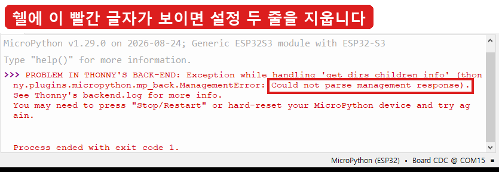
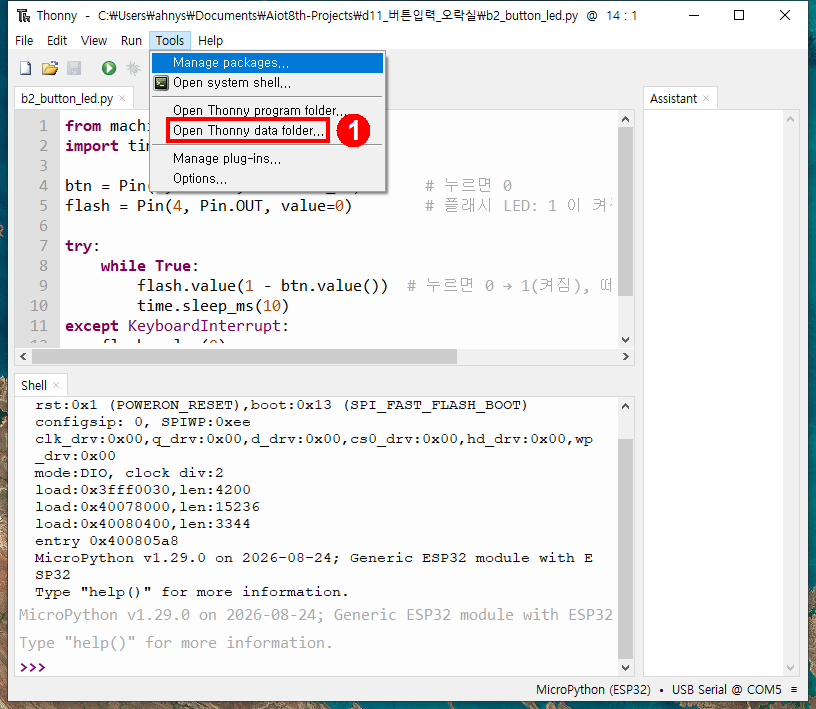
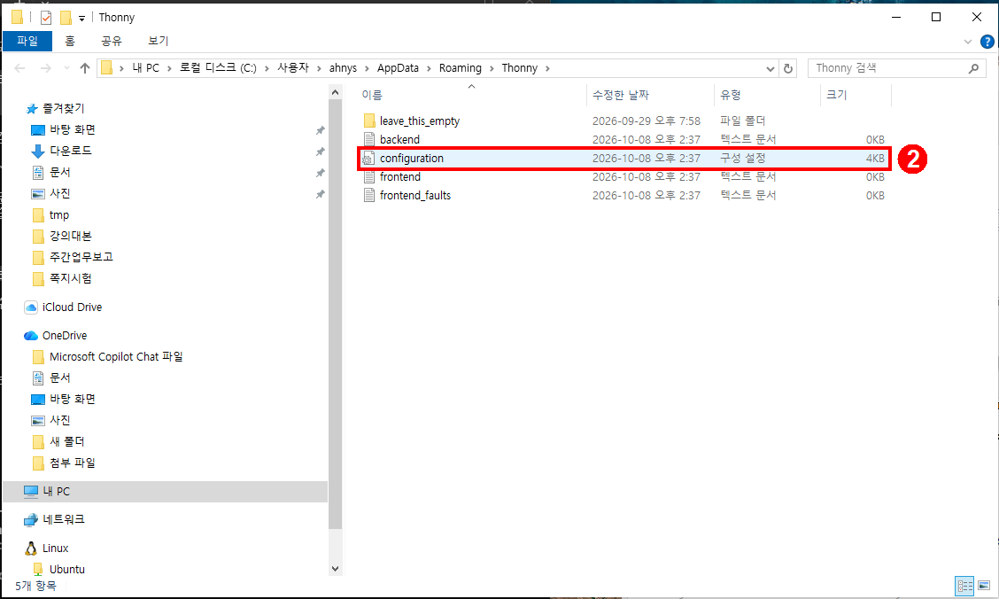
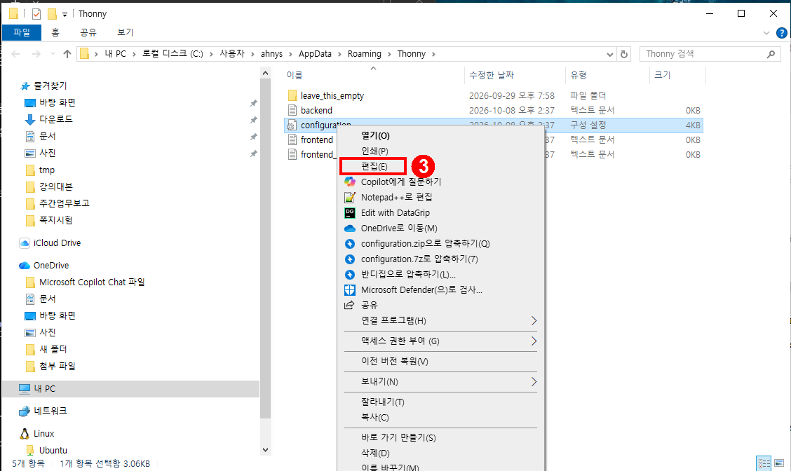
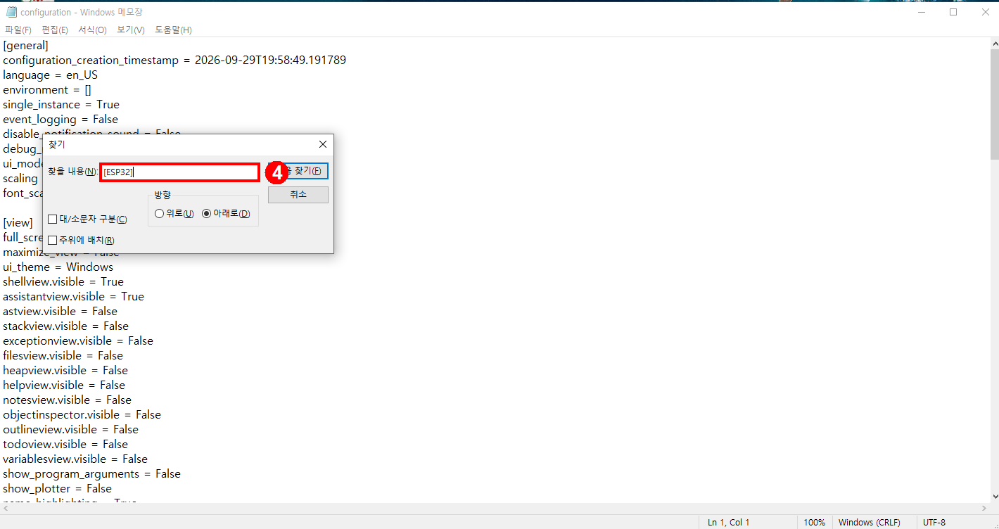
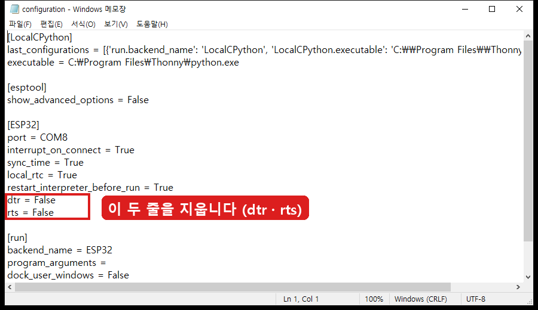
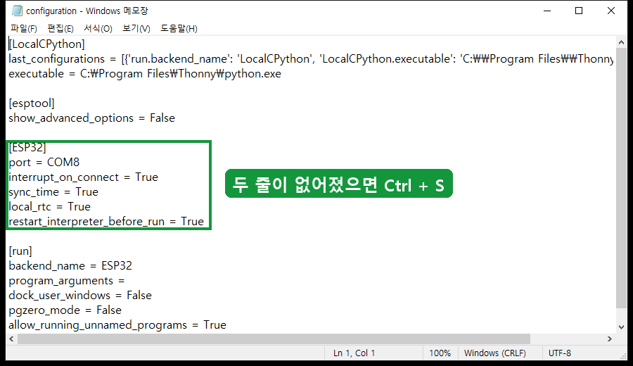
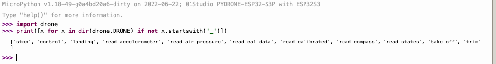

# 토니 설정 — dtr · rts 두 줄 지우기 (pyDrone 으로 바꾼 뒤 한 번만)

> 언제 하나: 보드를 **pyDrone 펌웨어(v1.18)** 로 바꿨는데 토니 연결이 안 될 때, 또 쉘 첫 줄이 `Generic ESP32S3` 인 채로 파일을 올렸더니 `Could not parse management response` 가 뜰 때.
> 왜 하나: ESP32-CAM 때 넣은 `dtr = False` · `rts = False` 두 줄이 토니 설정에 남아 있다. 이 두 줄이 **없어야** 드론키트와 통신이 정상으로 이어진다. 두 줄을 지우면 기본 설정으로 돌아간다.
> 이 카드의 그림은 이 PC 의 실제 설정 파일 내용으로 찍었다.

# 이런 빨간 글자가 보일 때

🖊️ 쉘에 `Could not parse management response` 가 보이면 보드 고장이 아니다. 아래 순서로 설정 두 줄을 지우면 해결된다
🖊️ 성공 표시: 토니를 다시 열었을 때 빨간 글자 없이 아래 MicroPython 장치 목록에 파일 이름이 보인다

## 먼저: 보드 펌웨어를 pyDrone 으로 (강사와 함께)
1. 토니 [옵션] → [인터프리터] → [Install or update MicroPython] 에서 상위 폴더(d18_드론비행)의 `pyDrone.bin` 을 설치한다 (교재 44~48쪽).
2. 설치가 끝나면 보드의 RST 를 누른다.
3. 아래 6단계로 설정의 두 줄을 지운다.

# 따라 하기 — 6단계 (토니를 끄고 저장하는 순서가 중요하다)

## 1/6 토니 메뉴에서 설정 폴더 열기

🖊️ 토니 위쪽 메뉴 Tools → **Open Thonny data folder...** 를 누른다
🖊️ 성공 표시: 탐색기 창이 새로 열린다

## 2/6 `configuration` 파일 찾고, 토니를 완전히 끄기

🖊️ 폴더 주소 끝이 `...\AppData\Roaming\Thonny` 이다
🖊️ 파일 이름이 `configuration` 으로만 보인다 (확장자 `.ini` 는 윈도우가 숨긴다). 종류가 **구성 설정** 인 파일이다
🖊️ **토니 창을 X 로 완전히 닫는다.** 토니가 켜져 있으면 고친 내용을 나중에 덮어쓴다
🖊️ 성공 표시: 작업표시줄에 토니 아이콘이 없다

## 3/6 `configuration` 을 메모장으로 열기

🖊️ 파일 위에서 **마우스 오른쪽 버튼 → 편집(E)** 을 누른다
🖊️ 성공 표시: 제목이 `configuration - Windows 메모장` 인 창이 뜬다

## 4/6 `[ESP32]` 위치 찾기

🖊️ 메모장에서 **Ctrl + F** → 찾을 내용에 `[ESP32]` 입력 (대괄호 포함) → Enter → 취소로 닫기
🖊️ 성공 표시: `[ESP32]` 글자가 파랗게 선택되어 있다

## 5/6 `dtr = False` · `rts = False` 두 줄 지우기

🖊️ `[ESP32]` 아래에서 빨간 박스 안의 두 줄을 찾는다: `dtr = False` 와 `rts = False`
🖊️ 두 줄을 마우스로 끌어 선택하고 **Delete** 를 눌러 지운다 (줄이 없는 학생은 이 단계를 건너뛴다)

## 6/6 저장하고 연결 확인

🖊️ 초록 박스처럼 `[ESP32]` 묶음에 `port` · `interrupt_on_connect` · `sync_time` · `local_rtc` · `restart_interpreter_before_run` 다섯 줄이 남으면 된다
🖊️ **Ctrl + S** 로 저장하고 메모장을 닫은 뒤 토니를 다시 연다
🖊️ 성공 표시: 쉘 맨 위에 `MicroPython v1.18 ... 01Studio PYDRONE` 이 보이고 `>>>` 가 뜬다 (그림 아래)

